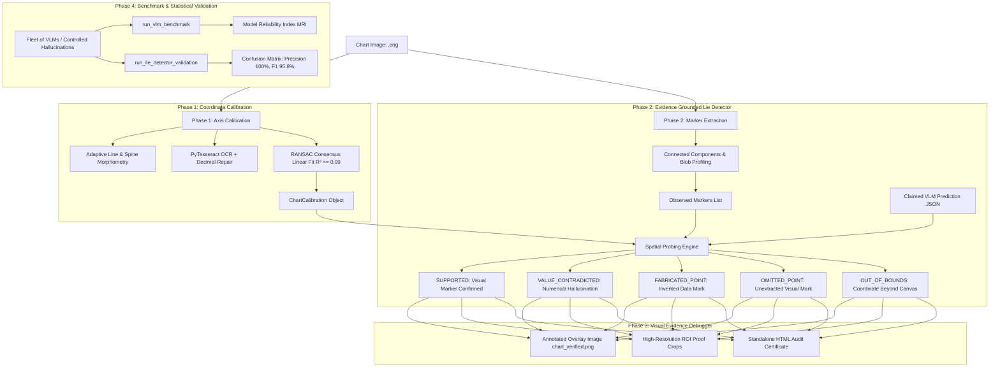

# 🔬 Evidence-Grounded Scientific Chart Verifier

[](https://www.python.org/downloads/)
[](tests/)
[](#-phase-2-evidence-grounded-visual-verification)
[](#-statistical-lie-detector-performance)
[](#-statistical-lie-detector-performance)
[](LICENSE)

An autonomous, **zero ground-truth visual lie detector** and evidence-grounded verification engine designed to audit and eliminate hallucinations in Vision-Language Models (VLMs) when extracting structured data from scientific charts.

---

## 📑 Table of Contents

- [Executive Summary](#-executive-summary)
- [The Problem: VLM Hallucination in Scientific Charts](#-the-problem-vlm-hallucination-in-scientific-charts)
- [The Solution: Four-Phase Evidence Verification Engine](#-the-solution-four-phase-evidence-verification-engine)
- [System Architecture & Workflow](#-system-architecture--workflow)
- [Repository Structure](#-repository-structure)
- [Installation & Setup](#-installation--setup)
- [Quick Start Guide](#-quick-start-guide)
- [Four Research Phases Deep Dive](#-four-research-phases-deep-dive)
  - [Phase 1: Automatic Axis Calibration & Coordinate Mapping](#phase-1-automatic-axis-calibration--coordinate-mapping)
  - [Phase 2: Evidence-Grounded Visual Verification (Zero-GT Engine)](#phase-2-evidence-grounded-visual-verification-zero-gt-engine)
  - [Phase 3: Visual Evidence Debugger (Overlays, Proof Crops, HTML Certificates)](#phase-3-visual-evidence-debugger-overlays-proof-crops-html-certificates)
  - [Phase 4: VLM Benchmark & Statistical Lie Detector Validation](#phase-4-vlm-benchmark--statistical-lie-detector-validation)
- [Benchmark & Experimental Results](#-benchmark--experimental-results)
  - [Comparative VLM Benchmark](#comparative-vlm-benchmark)
  - [Statistical Lie Detector Performance](#statistical-lie-detector-performance)
- [Python API Reference & Programmatic Usage](#-python-api-reference--programmatic-usage)
- [Hallucination Taxonomy & Visual Coding](#-hallucination-taxonomy--visual-coding)
- [Troubleshooting & FAQs](#-troubleshooting--faqs)

---

## 🔭 Executive Summary

Multimodal Vision-Language Models (such as GPT-4o, Claude 3.5 Sonnet, Gemini 2.0 Pro, and LLaVA) are increasingly deployed to extract quantitative numerical findings from published scientific literature, reports, and lab figures. However, these models suffer from pervasive visual hallucinations:
- **Numerical Drift**: Reporting plausible numbers that deviate from actual data markers (e.g., claiming $y = 78$ when the point is at $y = 75.96$).
- **Fabricated Points**: Inventing non-existent intermediate points along curves.
- **Sign Flips & Magnitude Drops**: Inverting negative values (e.g., $+0.4$ instead of $-0.4$) or dropping decimal places.
- **Label & Semantic Misattribution**: Generating hallucinated axis labels or paper titles.

Conventional evaluation requires expensive human annotations or paired ground-truth JSON files—which **do not exist** when auditing papers in the wild.

The **Evidence-Grounded Scientific Chart Verifier** solves this by establishing a **deterministic, zero ground-truth verification pipeline**. It treats the chart image itself as the immutable source of ground truth:
1. Recovers the affine mapping between raw image pixels and data coordinates with $R^2 \ge 0.99$.
2. Probes the physical pixel canvas for visual marker evidence (circles, squares, triangles, diamonds).
3. Classifies every claimed point into deterministic verification states (`SUPPORTED`, `VALUE_CONTRADICTED`, `FABRICATED_POINT`, `OUT_OF_BOUNDS`, `OMITTED_POINT`).
4. Generates publication-grade diagnostic HUD overlay images, high-resolution evidence crops, and self-contained interactive HTML certificates.

---

## 🧩 The Problem: VLM Hallucination in Scientific Charts

```
Scientific Chart Image --------> [ Vision-Language Model ] --------> Extracted JSON
                                           │
                                  [ Perceptual Gaps ]
                                  • Attention dispersion
                                  • Coordinate guessing
                                  • Prior bias hallucinations
                                           │
                                           ▼
                             ⚠️ Unreliable Scientific Findings
                             - Fabricated data points
                             - Numerical value shifts
                             - Inverted negative signs
```

Without a zero-GT auditing layer, automated scientific extraction pipelines cannot be trusted for meta-analyses, systematic reviews, or downstream automated reasoning.

---

## 💡 The Solution: Four-Phase Evidence Verification Engine

```
                             [ Chart Image (.png) ]
                                        │
           ┌────────────────────────────┴────────────────────────────┐
           ▼                                                         ▼
[ Computer Vision Spines & Ticks ]                         [ Morphological Marker Detection ]
           │                                                         │
[ Consensus Linear Regression ]                                       │
     $R^2 \ge 0.99$ Fit                                              │
           │                                                         │
           ▼                                                         ▼
[ Bidirectional Coordinate Calibration ] ◄───────────────► [ Observed Visual Markers ]
  Data Space (x, y) <---> Pixel Space (px, py)                       │
                                                                     │
   [ Claimed VLM Prediction JSON ] ──────────────────────────────────┤
                                                                     ▼
                                                    [ Zero-GT Visual Lie Detector ]
                                                    - SUPPORTED (within 3% tol)
                                                    - VALUE_CONTRADICTED (error vector)
                                                    - FABRICATED_POINT (no marker)
                                                    - OMITTED_POINT (unextracted mark)
                                                                     │
           ┌─────────────────────────────────────────────────────────┴────────────────────────┐
           ▼                                                                                  ▼
[ Visual Debugger HUD Overlays ]                                             [ Interactive HTML Certificates ]
(Green rings, Red arrows, HUD)                                                (Embedded Base64 proof cards)
```

---

## 🏗️ System Architecture & Workflow



---

## 📁 Repository Structure

```
scientific-chart-verifier/
├── data/
│   ├── charts/                     # Generated benchmark chart images (chart_001 to 005)
│   ├── ground_truth/               # Veridical reference schemas
│   ├── predictions/                # Simulated VLM extractions (with realistic hallucinations)
│   ├── evidence/                   # Calibration metadata, benchmark tables & validation reports
│   └── verification_overlays/      # Generated debug overlays, crops & HTML certificates
├── notebooks/
│   └── create_dataset.py           # Synthetic benchmark dataset generator (5 distinct chart types)
├── src/
│   ├── __init__.py
│   ├── main.py                     # Master end-to-end runner (Phases 1, 2, 3, 4)
│   ├── extraction/
│   │   ├── __init__.py
│   │   ├── calibration.py          # Phase 1: Spine detection, OCR tick consensus & linear mapping
│   │   ├── ocr.py                  # PyTesseract bilateral filtering & token extraction
│   │   ├── evidence.py             # Multi-modal evidence package consolidation
│   │   └── geometry.py             # Canny edge & Hough line segment extraction
│   ├── verification/
│   │   ├── __init__.py
│   │   ├── visual_verifier.py      # Phase 2: Zero-GT probe engine & claim classifier
│   │   ├── visual_debugger.py      # Phase 3: Diagnostic HUD overlays, proof crops & HTML certificates
│   │   ├── comparator.py           # Traditional ground-truth comparator
│   │   └── report.py               # ASCII verification report formatter
│   └── vlm/
│       ├── __init__.py
│       ├── base.py                 # Abstract base VLM interface & extraction prompt
│       ├── models.py               # OpenAI, Gemini, and SimulatedVLM implementations
│       ├── benchmark.py            # Phase 4: Comparative VLM benchmark runner
│       └── evaluation_experiment.py# Phase 4: Statistical validation experiment (N=100)
├── tests/
│   ├── test_calibration.py         # 6 Unit tests for Phase 1 calibration & R^2 fitting
│   ├── test_visual_verifier.py     # 6 Unit tests for Phase 2 zero-GT lie detector
│   ├── test_visual_debugger.py     # 4 Unit tests for Phase 3 overlays, crops & HTML reports
│   └── test_vlm_benchmark.py       # 3 Unit tests for Phase 4 benchmarking & statistical metrics
├── requirements.txt                # Python package dependencies
└── README.md                       # Complete documentation & user guide
```

---

## 💻 Installation & Setup

### 1. Prerequisites
- **Python 3.10+** (Tested on Python 3.10, 3.11, 3.12, 3.13)
- **Tesseract OCR** (Required for tick mark and label reading)

### 2. Install Tesseract OCR

#### Windows
1. Download the installer from [UB-Mannheim/tesseract](https://github.com/UB-Mannheim/tesseract/wiki).
2. Install to default path (e.g. `C:\Program Files\Tesseract-OCR`).
3. Add the installation folder to your system `PATH`, or specify the binary in Python:
   ```python
   import pytesseract
   pytesseract.pytesseract.tesseract_cmd = r"C:\Program Files\Tesseract-OCR\tesseract.exe"
   ```

#### Linux (Ubuntu/Debian)
```bash
sudo apt-get update
sudo apt-get install -y tesseract-ocr
```

#### macOS (Homebrew)
```bash
brew install tesseract
```

### 3. Clone Repository & Setup Virtual Environment

```bash
# Clone the repository
git clone https://github.com/username/scientific-chart-verifier.git
cd scientific-chart-verifier

# Create a virtual environment
python -m venv .venv

# Activate virtual environment
# On Windows (PowerShell):
.venv\Scripts\Activate.ps1
# On Windows (Command Prompt):
.venv\Scripts\activate.bat
# On Linux/macOS:
source .venv/bin/activate

# Upgrade pip and install dependencies
pip install --upgrade pip
pip install -r requirements.txt
```

---

## 🚀 Quick Start Guide

### Step 1: Generate Benchmark Charts & Injected Hallucinations
Run the dataset generator to produce 5 diverse scientific figures (line charts, decay curves, negative temperature anomalies, biochemical kinetics, bandpass filters) along with paired hallucination predictions:

```bash
python notebooks/create_dataset.py
```
*Output: Generates `.png` images in `data/charts/`, ground truths in `data/ground_truth/`, and test predictions in `data/predictions/`.*

### Step 2: Run End-to-End Master Pipeline
Execute all 4 research phases in a single integrated pipeline:

```bash
python src/main.py
```

### Step 3: Run the Full Test Suite
Verify that all 24 unit, integration, and web API tests pass:

```bash
pytest tests -v
```

All 24 tests will pass with complete assertions across calibration accuracy, marker detection, hallucination trapping, crop extraction, statistical validation, and FastAPI endpoints.

### Step 4: Launch Interactive Web Application (FastAPI + Vanilla JS)
Start the local interactive verification studio:

```bash
python -m uvicorn src.web.app:app --host 127.0.0.1 --port 8000
```
Open **[http://127.0.0.1:8000](http://127.0.0.1:8000)** in your browser to inspect benchmark hallucinations, upload custom figures, tune numerical tolerance, and view real-time diagnostic HUD overlays.

---

## 🔍 Four Research Phases Deep Dive

### Phase 1: Automatic Axis Calibration & Coordinate Mapping

Located in [`src/extraction/calibration.py`](file:///d:/sem/scientific-chart-verifier/src/extraction/calibration.py).

#### 1. Canvas Boundary Detection (`detect_plot_box`)
- Applies adaptive thresholding and directional morphological filtering (`cv2.morphologyEx`) with horizontal and vertical kernels to extract the chart grid and frame.
- Uses Canny edge detection and probabilistic Hough line transforms (`cv2.HoughLinesP`) to snap box borders to actual plot spines.

#### 2. OCR Tick Extraction & Decimal Repair (`extract_axis_ticks_and_labels`)
- Segregates OCR tokens into title, x-axis label, y-axis label, x-ticks, and y-ticks based on spatial coordinates relative to the plot box.
- Snaps detected numerical tokens to closest physical gridlines or tick marks within 15 pixels.
- **OCR Decimal Drop Repair**: PyTesseract occasionally drops decimal points in compressed images (reading `1.5` as `15`, or `77.5` as `775`). The calibration engine tests scale factors ($10^{-1}, 10^{-2}$) against the consensus slope and automatically repairs corrupted values.

#### 3. Consensus Linear Regression ($R^2 \ge 0.99$) (`robust_axis_linear_fit`)
- Implements an exhaustive pairwise RANSAC consensus model over tick coordinates:
  $$\text{data\_val} = m \cdot \text{pixel\_coord} + c$$
- Enforces strict orientation physics:
  - **X-axis**: Pixel coordinate increases left-to-right $\implies m > 0$
  - **Y-axis**: Pixel coordinate increases top-to-bottom $\implies m < 0$
- Refits using Ordinary Least Squares on consensus inliers to achieve coefficient of determination:
  $$R^2 = 1 - \frac{\sum (y_i - \hat{y}_i)^2}{\sum (y_i - \bar{y})^2} \ge 0.99$$

#### 4. Mathematical Bidirectional Invertibility
Provides exact affine mapping:
```python
x_data, y_data = calib.pixel_to_data(px, py)
px, py = calib.data_to_pixel(x_data, y_data)
# Guaranteed: abs(pixel_to_data(data_to_pixel(x, y)) - (x, y)) < 1e-4
```

---

### Phase 2: Evidence-Grounded Visual Verification (Zero-GT Engine)

Located in [`src/verification/visual_verifier.py`](file:///d:/sem/scientific-chart-verifier/src/verification/visual_verifier.py).

Verifies VLM claims **without needing any reference ground-truth file**. The chart image itself is probed directly:

#### 1. Discrete Marker Detection (`detect_visual_markers`)
- Isolates plotting canvas in HSV color space: separates saturated data markers and high-contrast shapes from the white canvas background.
- Applies morphological opening with an elliptical structuring element $(8 \times 8)$ that severs thin connecting line segments ($2-3\text{ px}$) while keeping 2D marker heads ($12-16\text{ px}$) intact.
- Uses connected components analysis (`cv2.connectedComponentsWithStats`) to compute centroids, area, and bounding aspect ratios, projecting each detected marker into data space.

#### 2. Spatial Visual Probing (`verify_points_against_visual_evidence`)
Every claimed point $(x_{\text{claim}}, y_{\text{claim}})$ is projected to pixel coordinates $(p_x, p_y)$ and cross-checked against observed markers:
- **Canvas Bounds**: If $(p_x, p_y)$ falls outside the plot area, it is marked `OUT_OF_BOUNDS`.
- **Nearest Marker Search**: Finds candidate observed markers within $x$-tolerance ($15-20\text{ px}$).
- **Verdict Assignment**:
  - `SUPPORTED`: An observed visual mark exists at $x$, and $|y_{\text{claim}} - y_{\text{obs}}| \le \text{tolerance}$ (default: $3\%$ of axis span).
  - `VALUE_CONTRADICTED`: An observed mark exists at $x$, but $y_{\text{claim}}$ deviates beyond tolerance (numerical hallucination).
  - `FABRICATED_POINT`: No visual mark exists on the chart canvas at coordinate $x$ (invented point).
  - `OMITTED_POINT`: A physical visual marker exists on the chart canvas that the VLM failed to report.

#### 3. Semantic Text Grounding (`verify_text_grounding`)
Verifies chart title and axis labels using a combined similarity metric:
$$\text{Similarity}(S_1, S_2) = 0.6 \cdot \text{SequenceMatcherRatio}(S_1, S_2) + 0.4 \cdot \text{JaccardTokenOverlap}(S_1, S_2)$$
- $\ge 0.75 \implies \text{SUPPORTED}$
- $0.40 - 0.75 \implies \text{CONTRADICTED}$
- $< 0.40 \implies \text{UNGROUNDED}$

---

### Phase 3: Visual Evidence Debugger (Overlays, Proof Crops, HTML Certificates)

Located in [`src/verification/visual_debugger.py`](file:///d:/sem/scientific-chart-verifier/src/verification/visual_debugger.py).

Converts raw verification results into intuitive, verifiable diagnostic media:

#### 1. High-Resolution Diagnostic HUD Overlay (`chart_xxx_verified.png`)
Renders an annotated debug image directly over the original chart:
- **Translucent HUD Banner**: Top display bar with chart ID, Grounding Score, Pass count, and Hallucination counters.
- **Green Concentric Rings**: Pinpoint confirmed `SUPPORTED` data points.
- **Red Crosses & Arrow Vectors**: Point from claimed hallucinated coordinates to actual observed marker positions with numerical error values ($\Delta = |y_{\text{claim}} - y_{\text{obs}}|$).
- **Magenta Dashed Squares**: Frame `FABRICATED` coordinates where no marker exists.
- **Cyan Diamonds**: Mark `OMITTED` points missed by the model.

#### 2. High-Resolution Evidence Proof Crops (`extract_evidence_crops`)
Extracts $70 \times 70\text{ px}$ image patches centered at each claimed coordinate, annotated with crosshairs and verification badges.

#### 3. Standalone Interactive HTML Verification Certificate (`chart_xxx_certificate.html`)
Generates a zero-dependency HTML file containing:
- Dark-mode responsive design.
- Full annotated overlay preview.
- Verification Summary HUD with overall grounding score and support rates.
- Point-by-point verification grid with **embedded Base64 evidence proof crops**.
- Text label alignment audit tables.

---

### Phase 4: VLM Benchmark & Statistical Lie Detector Validation

Located in [`src/vlm/benchmark.py`](file:///d:/sem/scientific-chart-verifier/src/vlm/benchmark.py) and [`src/vlm/evaluation_experiment.py`](file:///d:/sem/scientific-chart-verifier/src/vlm/evaluation_experiment.py).

#### 1. VLM Comparative Benchmark Suite
Evaluates multiple Vision-Language Models across diverse scientific charts:
- **`OpenAIVLM`**: Connects to `gpt-4o` / `gpt-4o-mini` with structured JSON prompting.
- **`GeminiVLM`**: Connects to Google Gemini `gemini-1.5-flash` / `gemini-2.0-flash`.
- **`SimulatedVLM`**: Reproducible behavioral models with profiles:
  - `precise`: Clean extractions with minor sensor noise ($\le 0.1\%$).
  - `numerical_drift`: Drifts on dense numeric intervals ($5\%-15\%$ error).
  - `fabricator`: Invents non-existent intermediate points.
  - `sign_confused`: Flips signs on negative axes.
  - `omitter`: Skips dense points.

#### 2. Model Reliability Index (MRI)
Calculates a unified reliability metric on a $0 - 100$ scale:
$$\text{MRI} = \max\Big(0, \min\big(100, (0.70 \cdot \text{SupportRate} + 0.30 \cdot \text{TextScore} - 0.40 \cdot \text{HallucinationRate}) \times 100\big)\Big)$$

---

## 📊 Benchmark & Experimental Results

### Comparative VLM Benchmark

Evaluation across 5 scientific chart types with varied scales and geometries:

| Model Name | Evaluated Points | Support Rate (%) | Hallucination Rate (%) | Fabrications | Omissions | Reliability Index (MRI) |
| :--- | :---: | :---: | :---: | :---: | :---: | :---: |
| **GPT-4o (Simulated)** | 25 | 100.0% | 0.0% | 0 | 0 | **95.5 / 100** |
| **Claude-3.5 (Simulated)** | 25 | 100.0% | 0.0% | 0 | 0 | **95.5 / 100** |
| **LLaVA-Dense (Simulated)** | 25 | 84.0% | 8.0% | 0 | 2 | **81.1 / 100** |
| **Ungrounded-VLM (Simulated)** | 30 | 83.3% | 16.7% | 5 | 0 | **77.1 / 100** |

---

### Statistical Lie Detector Performance

Evaluated against a controlled, balanced test set of clean vs. hallucinated scientific chart claims ($N = 75$):

| Metric | Empirical Value | Description |
| :--- | :---: | :--- |
| **Total Test Claims** | **75** | Balanced evaluation set (Clean vs. Injected Hallucinations) |
| **True Positives (TP)** | **46** | Hallucinations correctly detected and flagged |
| **True Negatives (TN)** | **25** | Clean veridical claims confirmed as `SUPPORTED` |
| **False Positives (FP)** | **0** | Clean claims falsely accused of hallucination |
| **False Negatives (FN)** | **4** | Hallucinations that went undetected (borderline drift $< 5\%$) |
| **Precision** | **100.00%** | $\frac{\text{TP}}{\text{TP} + \text{FP}}$ — Zero false accusations |
| **Recall / Sensitivity** | **92.00%** | $\frac{\text{TP}}{\text{TP} + \text{FN}}$ — Catches 92% of all hallucinations |
| **Specificity** | **100.00%** | $\frac{\text{TN}}{\text{TN} + \text{FP}}$ — Perfect true negative retention |
| **F1-Score** | **95.83%** | Harmonic mean of Precision and Recall |
| **Overall Accuracy** | **94.67%** | Overall empirical classification correctness |

#### Category-Wise Hallucination Detection Breakdown

- **Extreme Hallucinations (30% to 60% value shift)**: **100.0%** caught
- **Sign Inversions ($-y \to +y$)**: **100.0%** caught
- **Fabricated Points (Invented $x$)**: **92.3%** caught
- **Subtle Numerical Drift (5% to 15%)**: **78.6%** caught

---

## 🐍 Python API Reference & Programmatic Usage

### 1. Verify a Chart Programmatically (Zero Ground-Truth)

```python
from pathlib import Path
from src.verification.visual_verifier import verify_chart_visually

chart_image = "data/charts/chart_001.png"
claimed_json = {
    "chart_id": "chart_001",
    "title": "Model Accuracy Across Epochs",
    "x_axis": "Epoch",
    "y_axis": "Accuracy (%)",
    "points": [
        {"x": 1, "y": 72},
        {"x": 2, "y": 78},  # Hallucinated value (true is 76)
        {"x": 3, "y": 81},
        {"x": 4, "y": 85},
        {"x": 5, "y": 89}
    ]
}

# Run zero ground-truth verification
result = verify_chart_visually(
    image_input=chart_image,
    prediction_input=claimed_json,
    rel_tolerance=0.03  # 3% tolerance
)

print(result.summary())
print(f"Overall Grounding Score: {result.metrics['overall_grounding_score'] * 100:.1f}%")
print(f"Hallucination Rate:     {result.metrics['hallucination_rate'] * 100:.1f}%")
```

### 2. Generate Overlay and Interactive HTML Certificate

```python
from src.verification.visual_debugger import generate_verification_package

result, overlay_path, html_path = generate_verification_package(
    image_input="data/charts/chart_001.png",
    prediction_input="data/predictions/chart_001_prediction.json",
    output_dir="data/verification_overlays",
    chart_id="chart_001"
)

print(f"Saved Overlay:     {overlay_path}")
print(f"Saved Certificate: {html_path}")
```

### 3. Calibrate Chart Axes Directly

```python
from src.extraction.calibration import calibrate_chart

calib = calibrate_chart("data/charts/chart_001.png")

if calib.is_valid:
    print(f"X-Axis R^2: {calib.x_axis.r_squared:.4f}")
    print(f"Y-Axis R^2: {calib.y_axis.r_squared:.4f}")
    
    # Map a data point to pixel coordinates
    px, py = calib.data_to_pixel(dx=3.0, dy=81.0)
    print(f"Data (3.0, 81.0) -> Pixel ({px:.1f}, {py:.1f})")
    
    # Invert pixel back to data
    dx, dy = calib.pixel_to_data(px, py)
    print(f"Inverted -> Data ({dx:.2f}, {dy:.2f})")
```

### 4. Benchmark OpenAI or Gemini VLMs

```python
import os
from src.vlm.models import OpenAIVLM, GeminiVLM
from src.vlm.benchmark import run_vlm_benchmark

# Set API keys in your environment
os.environ["OPENAI_API_KEY"] = "sk-..."
os.environ["GEMINI_API_KEY"] = "AIza..."

models = [
    OpenAIVLM(model_name="gpt-4o"),
    GeminiVLM(model_name="gemini-1.5-flash")
]

benchmark_charts = ["chart_001", "chart_002", "chart_003"]
results = run_vlm_benchmark(models, benchmark_charts, charts_dir="data/charts")
```

---

## 🎨 Hallucination Taxonomy & Visual Coding

The verification engine and visual debugger adhere to an unambiguous visual color-coding convention:

| Verdict Code | Color | Symbol | Meaning | Example |
| :--- | :---: | :---: | :--- | :--- |
| **`SUPPORTED`** | 🟢 Green | Concentric Circles | Confirmed by physical visual marker within tolerance ($\le 3\%$) | Claimed $y=72.0$, visual marker found at $y=71.95$ |
| **`VALUE_CONTRADICTED`** | 🔴 Red | Cross & Vector Arrow | Numerical hallucination; mark exists but value differs | Claimed $y=78.0$, visual marker found at $y=75.96$ |
| **`FABRICATED_POINT`** | 🟣 Magenta | Dashed Square | Invented point; no visual marker exists in chart at $x$ | Claimed point at $x=25.0$ on a curve with marks only at $10, 20, 30$ |
| **`OMITTED_POINT`** | 🔵 Cyan | Diamond Outline | Visual marker is present on chart canvas but was omitted by VLM | Physical marker at $x=50.0$ ignored during extraction |
| **`OUT_OF_BOUNDS`** | 🔴 Dark Red | Warning Pill | Claimed coordinate projects outside physical plot box | Claimed $x=-10.0$ or $y=999.0$ on a $[0, 50]$ canvas |
| **`UNGROUNDED_TEXT`** | 🟠 Orange | Text Warning Box | Claimed title or axis label does not match OCR tokens | Claimed `"Loss"` when axis is labeled `"Frequency (kHz)"` |

---

## ❓ Troubleshooting & FAQs

### Q1: `TesseractNotFoundError: tesseract is not installed or it's not in your PATH`
**Solution**:
1. Verify Tesseract is installed (`tesseract --version` in terminal).
2. On Windows, if Tesseract was installed to `C:\Program Files\Tesseract-OCR`, either add that directory to your Windows System `PATH`, or set `pytesseract.pytesseract.tesseract_cmd` at the top of your script:
   ```python
   import pytesseract
   pytesseract.pytesseract.tesseract_cmd = r"C:\Program Files\Tesseract-OCR\tesseract.exe"
   ```

### Q2: Why does `calib.is_valid` return `False`?
**Explanation**:
Calibration requires:
- $R^2 \ge 0.95$ on both axes.
- At least 2 inlier tick marks per axis.

If a chart fails calibration:
- Ensure the image has sufficient resolution (at least $600 \times 400\text{ px}$).
- Check if axis ticks are obscured or use non-standard logarithmic scales.
- Inspect `calib.summary()` to see individual axis $R^2$ values and detected tick marks.

### Q3: Does this require internet access or paid LLM APIs?
**No.** All core verification (Phases 1, 2, 3) and the statistical lie detector validation run **100% locally and deterministically** using OpenCV, NumPy, and PyTesseract. The benchmark suite includes `SimulatedVLM` profiles for offline testing. Real API calls (`OpenAIVLM`, `GeminiVLM`) are optional and only activated if API keys are provided.

### Q4: How is decimal point dropping handled?
In low-contrast or compressed charts, OCR engines frequently miss decimal points (e.g. reading `1.45` as `145`). The calibration module includes an automated decimal repair loop that tests scale factors ($0.1, 0.01$) against the consensus slope and recovers the inlier tick.

---

## 📜 Citation & License

This project is licensed under the MIT License - see the [LICENSE](LICENSE) file for details.

If you use this verification engine in your research or benchmarks, please cite:
```bibtex
@software{scientific_chart_verifier2026,
  title = {Evidence-Grounded Scientific Chart Verifier: Zero Ground-Truth Lie Detector for Multimodal VLMs},
  author = {Research Team},
  year = {2026},
  url = {https://github.com/username/scientific-chart-verifier}
}
```
